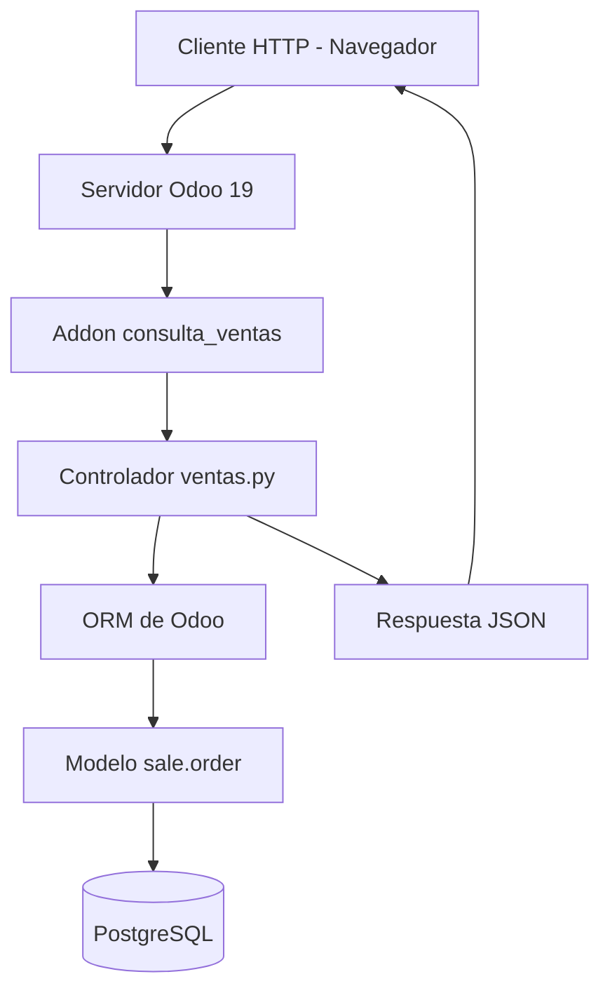

# Arquitectura de Software - Consulta de Ventas Odoo 19

## 1. Introducción

Este proyecto desarrolla un módulo personalizado para Odoo 19
que permite consultar las ventas confirmadas de un cliente
durante un mes mediante una API HTTP.

Se aprovechan las funcionalidades existentes del ERP,
sin modificar su código fuente original.

## 2. Arquitectura utilizada

Se utiliza la arquitectura modular de Odoo, basada en
un núcleo extensible mediante módulos (addons).

Este mecanismo presenta características similares al
patrón Microkernel o arquitectura basada en plugins.

El núcleo de Odoo proporciona:
- Enrutamiento HTTP.
- Autenticación y autorización.
- ORM para acceder a los modelos.
- Gestión de módulos.
- Integración con PostgreSQL.

El módulo personalizado incorpora la funcionalidad
de consulta mensual de ventas.

## 3. Diagrama de arquitectura





## 4. Componentes

### Núcleo de Odoo

Proporciona los servicios necesarios para ejecutar
y administrar los módulos.

### Módulo Sales

Proporciona el modelo sale.order, que representa
los pedidos de venta.

### Módulo consulta_ventas

Implementa el endpoint GET /api/consulta-ventas,
que permite consultar los pedidos confirmados.

### PostgreSQL

Almacena la información de clientes y ventas.

## 5. Flujo de funcionamiento

1. El usuario inicia sesión en Odoo.
2. Envía una solicitud HTTP GET.
3. Odoo verifica la autenticación.
4. El controlador comprueba los permisos de Ventas.
5. Se validan los parámetros de consulta.
6. El ORM busca los pedidos confirmados del cliente.
7. Se calcula el importe total del periodo.
8. La API devuelve una respuesta JSON.

## 6. Seguridad

El endpoint utiliza auth='user'.

También verifica la pertenencia al grupo
sales_team.group_sale_salesman.

Las consultas utilizan el ORM sin sudo(),
respetando las reglas de acceso de Odoo.

## 7. Ventajas arquitectónicas

- Extensibilidad mediante addons.
- Separación del código personalizado.
- Reutilización del modelo sale.order.
- Mantenimiento independiente del núcleo.
- Integración mediante una API HTTP.

## 8. Conclusión

El proyecto demuestra cómo extender las capacidades
de Odoo 19 mediante un módulo personalizado.

Se implementó una consulta mensual de ventas,
se probaron controles de acceso y se documentó
el endpoint utilizando OpenAPI 3.0.
```
